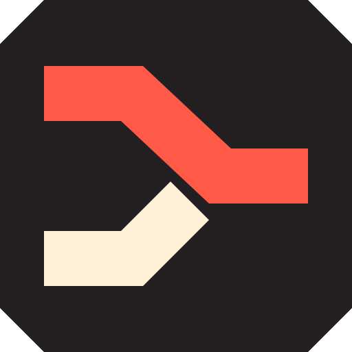
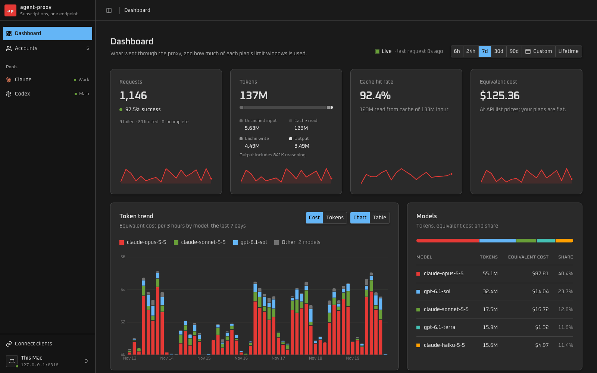
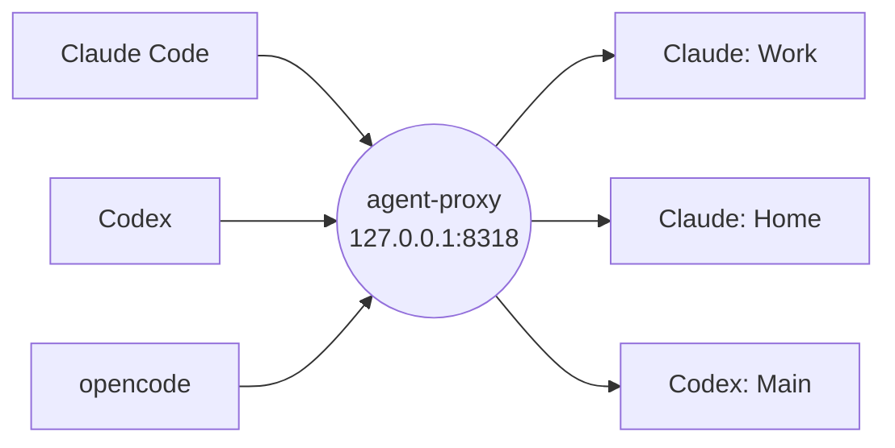

<div align="center">



# agent-proxy

**All your Claude and Codex subscriptions behind one local endpoint.**

Point Claude Code, Codex, and opencode at one address. agent-proxy picks the account,<br>
moves to the next one when a limit hits, and shows you what you used.

[](https://github.com/endalk200/agent-proxy/actions/workflows/ci.yml)




</div>

## Why

You pay for more than one plan: a Claude Max plan for work, another for home, a ChatGPT plan for Codex. Each client signs in to one account. When that account hits its 5-hour limit, you sign out, sign in to another, and lose your place.

agent-proxy holds every account. Your clients sign in to nothing. They send requests to the proxy, and the proxy spends whichever account has room.

## Features

- **One endpoint, every account.** Add as many Claude and Codex accounts as you have, and give them an order.
- **Native routing.** Claude Code spends only Claude accounts, Codex only Codex accounts, and opencode either. Requests pass through in the provider's own format, and prompts are never rewritten.
- **Failover before the client notices.** When an account hits a limit, the request moves to the next account and the session moves with it.
- **Prompt cache stays warm.** A session stays on one account, so the provider's cache keeps working.
- **A live dashboard.** Requests, tokens, cache hit rate, equivalent API cost, and every 5-hour and weekly limit window, as they happen.
- **Local and private.** It runs on your machine. Accounts and usage live in files only you can read, and every request must carry the proxy key.

## How it works



`agent-proxy connect <client>` edits the client's own config to point at the proxy, and `disconnect` undoes it. The proxy chooses the account and never the API. Read [how requests are routed](docs/routing.md) for the details.

## Quick start

You need [Bun](https://bun.sh) 1.4.4 and macOS. agent-proxy builds from source into one binary, `~/.local/bin/agent-proxy`.

```sh
git clone https://github.com/endalk200/agent-proxy.git
cd agent-proxy
bun install
bun run install-local                 # build and install the binary
agent-proxy daemon install            # start the daemon now and at every login

agent-proxy accounts add claude       # sign in through the browser
agent-proxy accounts add codex
agent-proxy connect claude-code       # also: codex, opencode
```

Open the dashboard at <http://127.0.0.1:8318>. To update, run `git pull` and `bun run install-local` again. To remove everything it installed, run `agent-proxy uninstall`.

## Documentation

| Guide                                      | Covers                                                |
| ------------------------------------------ | ----------------------------------------------------- |
| [Install and run](docs/install.md)         | Install, update, uninstall, and run the daemon        |
| [Manage accounts](docs/accounts.md)        | Add, order, disable, and remove accounts              |
| [Connect your clients](docs/clients.md)    | Claude Code, Codex, opencode, and the proxy key       |
| [How requests are routed](docs/routing.md) | Sessions, priorities, limits, and failover            |
| [Usage and limit windows](docs/usage.md)   | What the dashboard counts and where it is stored      |
| [Configuration](docs/configuration.md)     | The config file                                       |
| [Develop agent-proxy](docs/development.md) | Commands, layout, tests, and the verification sandbox |

## Status

agent-proxy is early and personal: it is built for its owner's workflow first, and others are welcome to use it. It is a lean alternative to [CLIProxyAPI](https://github.com/router-for-me/CLIProxyAPI), with only the providers, clients, and options its owner uses.

Use it only with accounts you own, and within each provider's terms.
